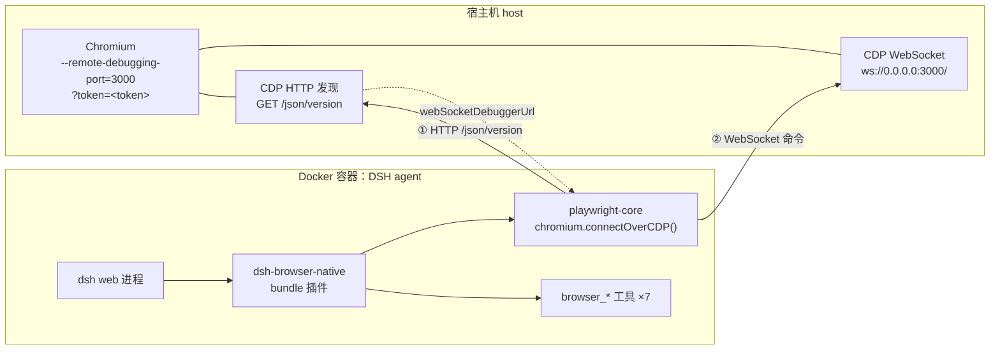
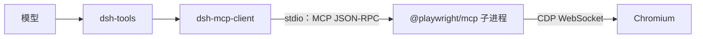
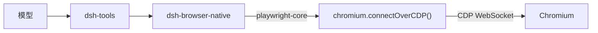
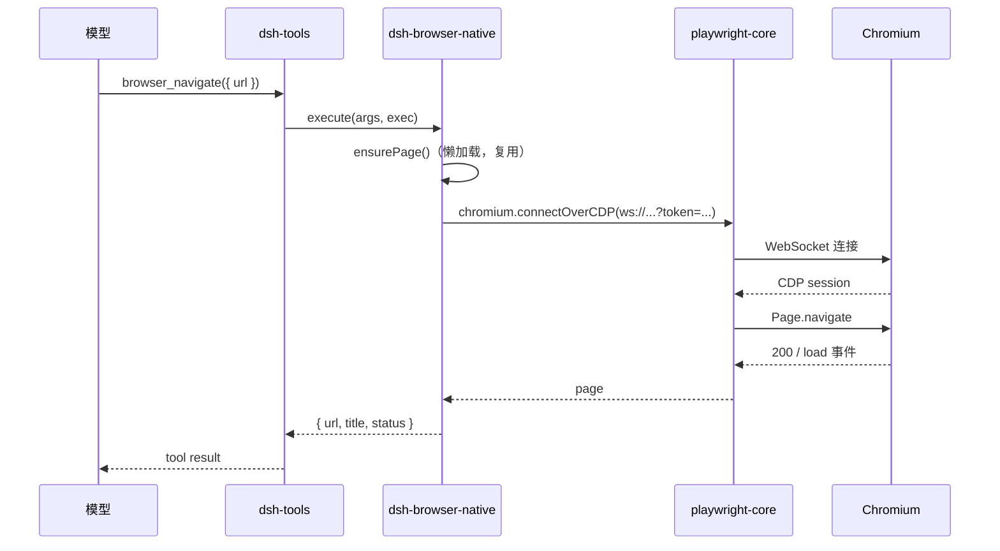

# 在 Docker 中让 DSH Agent 操作浏览器

> 本文基于 `dsh-browser-native` 与第三方 `dsh-browser-tool` 的实测总结。
> 环境：DSH `0.2.1-rc.2`、Node `22.23.4`、`playwright-core 1.64.1`、Chrome `156.0.8078.4`。
> 文中「实测」均指本次任务中实际跑过的命令与输出；推断会显式标注。

---

## 0. 一句话概括

DSH agent 本身**不内置浏览器**。它通过 **CDP（Chrome DevTools Protocol）** 操作宿主上的 Chromium：容器内的 agent 用 WebSocket 连到宿主的 CDP 端点，把「导航 / 点击 / 输入 / 截图」翻译成 CDP 命令。

因此「在 Docker 里用浏览器」本质是两件事：

1. **浏览器在哪**：通常跑在宿主机（或另一个容器 / 远程服务），暴露一个 CDP 端口；
2. **agent 怎么连**：DSH 里由插件（MCP 或原生 tool）持有一个 CDP 客户端，连上去。

---

## 1. 部署拓扑



要点：

- 容器通过 **`host.docker.internal`** 访问宿主端口；在 Linux 上它是 docker 注入的 `host-gateway`，在 Docker Desktop（macOS/Windows）上由 Docker 内置 DNS 解析。
- CDP 是**两段式**协议：
  - 先发 HTTP `GET /json/version`，拿到 `webSocketDebuggerUrl`；
  - 再连这个 WebSocket，收发 JSON 命令。
- 端点如果带 token，token 必须**同时**覆盖这两段（HTTP 与 WS）。

---

## 2. 组件清单

| 组件 | 所在位置 | 角色 |
|---|---|---|
| `dsh web` | 容器 | agent 宿主进程，加载 profile 与插件 |
| cordis | 容器 | DSH 的插件/服务框架（插件按 `inject` 声明依赖） |
| `@deepseek-ai/dsh-tools` | 容器 | 工具注册表，提供 `defineTool` / `ctx.tools.register` |
| `dsh-browser-native` | 容器 | 本插件：注册 `browser_*` 工具，持有 CDP 会话 |
| `playwright-core` | 容器 | CDP 客户端，`chromium.connectOverCDP(endpoint)` |
| Chromium | 宿主 | 被操作对象，暴露 CDP 端口 |
| `host.docker.internal` | 容器网络 | 容器到宿主的地址 |

> 可选：如果走 MCP 路径，还会多一个 `@playwright/mcp` 子进程（见第 3 节）。

---

## 3. 两条接入路径

DSH 里让模型「用上浏览器」有两种形态，二者最终都落到 CDP，区别只在中间层。

### 3.1 路径 A：MCP（`@playwright/mcp`）



- `dsh-mcp-client` 以 **stdio transport** 拉起 `@playwright/mcp` 子进程，通过 stdin/stdout 传 MCP JSON-RPC；
- 子进程内部用 Playwright 连 CDP，把 MCP 工具调用翻成 CDP；
- 工具名形如 `mcp__playwright__browser_navigate`。

优点：不写代码，配置一个 `insert` 即可；缺点：多一层 MCP 协议与子进程生命周期，工具粒度由上游决定。

### 3.2 路径 B：原生 tool 插件（`dsh-browser-native`）



- 插件 `inject = ['tools']`，在 `apply` 里用 `defineTool` + `ctx.tools.register` 注册 7 个工具；
- 工具执行时懒加载 `chromium.connectOverCDP(cdpUrl)`，复用同一个 `Browser`；
- 工具名形如 `browser_navigate`。

优点：少一层协议、工具粒度可控、错误直接抛给模型；缺点：要自己写插件并维护。

---

## 4. CDP 与鉴权

### 4.1 端点形态

CDP 端点有三种常见写法：

| 写法 | 用途 |
|---|---|
| `http://host:9222` | 无鉴权，客户端先 GET `/json/version` |
| `ws://host:9222/devtools/browser/<id>` | 直接给 WebSocket |
| `ws://host:3000/?token=...` | WebSocket + query token（本次环境） |

### 4.2 本次环境的实测行为

```text
GET http://host.docker.internal:3000/json/version            → 401 Bad or missing authentication
GET http://host.docker.internal:3000/json/version?token=...  → 200
  { "Browser": "Chrome/156.0.8078.4",
    "webSocketDebuggerUrl": "ws://0.0.0.0:3000/" }
ws://host.docker.internal:3000/?token=... 握手成功；
  发 { "id":1, "method":"Browser.getVersion" } → Chrome/156.0.8078.4
```

结论：

- 该端点**要求 token**，匿名 `/json/version` 是 401；
- 带 `?token=` 的 HTTP 与 WS 都能过；
- `webSocketDebuggerUrl` 返回的是 `ws://0.0.0.0:3000/`，**不含 token**。

### 4.3 为什么 `browserURL` 会失败

`puppeteer.connect({ browserURL })` 内部是：

```js
const endpointURL = new URL('/json/version', browserURL);
```

这会带来两个硬限制：

1. `browserURL = "ws://..."` → `new URL('/json/version', 'ws://...')` 产出 ws URL，后续 `fetch` 直接失败；
2. `browserURL = "http://host:3000/?token=..."` → `new URL('/json/version', ...)` **丢掉 query**，变成 `http://host:3000/json/version`，匿名请求 401。

而 `playwright-core` 的 `chromium.connectOverCDP(endpoint)` 直接接收 `ws://` 端点，**query 原样保留**——这是 `dsh-browser-native` 选它的原因。

---

## 5. 工具调用时序

以 `browser_navigate` 为例（原生 tool 路径）：



`browser_close` 只做 `browser.close()`（断开连接），**不会**杀宿主浏览器；宿主侧的 Chromium 继续运行，可再次 attach。

---

## 6. 实现要点（dsh-browser-native）

- **插件形态**：bundle 插件。`package.json` 声明 `dsh.bundle.patch`，`cordis.patch.yml` 里 `- insert: - id: dsh-browser-native`，profile 的 `dsh.profile.bundles` 追加该包。
- **工具注册**：`inject = ['tools']`，每个工具由 `defineTool({ name, description, parameters, output: { schema, render }, execute })` 定义，再 `ctx.tools.register(tool)`。
- **连接管理**：`CdpSession` 懒加载 + 进程内复用；并发首次调用共享同一个 in-flight promise；`browser_close` 只 disconnect。
- **配置**：`Config` 含 `cdpUrl` / `connectTimeoutMs` / `actionTimeoutMs` / `screenshotDir`；环境变量 `DSH_BROWSER_CDP_URL` 优先于配置。
- **错误**：连接失败、选择器超时、参数缺失都直接抛给模型，不静默降级。

---

## 7. 踩坑对照表

| 现象 | 原因 | 处理 |
|---|---|---|
| `puppeteer.connect` 报 401 | `/json/version` 匿名被拒，`new URL` 又丢了 query token | 改用 `playwright.connectOverCDP(ws://...?token=)` |
| `ws://` 传进 `browserURL` 失败 | `browserURL` 只认 HTTP 发现路径 | 同上 |
| 插件装了但工具不出现 | bundle 没进 `dsh.profile.bundles`，或 patch 未生效 | 查 `dsh --dump-config` 组合树，重启 dsh |
| `pnpm publish` 报 staging 限制 | token 被 package access 限制为 staged publishing | 用 `npm stage publish` + `npm stage approve` |
| `error: cannot find package '@deepseek-ai/dsh-tools'` | profile 的 `node_modules` 解析不到宿主运行时 | 依赖声明为 peer，由 DSH 运行时的 installation scope 提供；不要塞进 dependencies 装第二份 |

> 「插件装了但工具不出现」的排查顺序：`dsh --dump-config | grep <plugin>` → 检查 `dsh.profile.bundles` → 检查插件 activate 日志 → 新开会话。

---

## 8. 最小复现清单

```bash
# 宿主：启动带 CDP 的 Chromium（示例，token 由你的网关决定）
# chromium --remote-debugging-port=3000

# 容器内：验证 CDP 可达
curl "http://host.docker.internal:3000/json/version?token=<token>"

# 安装插件
dsh plugin --profile web add ./dsh-browser-native-0.1.0.tgz
# profile package.json: dsh.profile.bundles += "dsh-browser-native"

# profile cordis.patch.yml
# - id: dsh-browser-native
#   config:
#     cdpUrl: "ws://host.docker.internal:3000/?token=<token>"

# 重启 dsh，新开会话
dsh --profile web --dump-config | grep dsh-browser-native
```

新会话工具列表应出现：`browser_navigate`、`browser_snapshot`、`browser_click`、`browser_type`、`browser_screenshot`、`browser_evaluate`、`browser_close`。

---

## 9. 结论

- Docker 里的 DSH agent 操作浏览器，**不依赖「在容器里装浏览器」**；依赖的是「容器能连到宿主/远端的 CDP 端点」。
- CDP 客户端的选择决定了端点兼容性：**`playwright.connectOverCDP` 能直接吃带 query token 的 `ws://`**，而 `puppeteer.browserURL` 的 HTTP 发现路径会丢 query、不认 ws。
- DSH 侧只需要一个 tool 插件把「CDP 客户端」包成模型可调用的工具；MCP 与原生 tool 是同一原理的两种封装。
